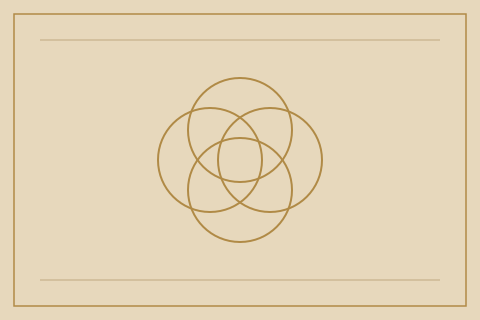

静默不是没有声音，而是声音退到纸的背面。你在正面写字，它在背面等你写完。

## 一 · 抄本

据<ref url="https://example.com/scriptorium">《缮写室手记》</ref>记载，抄写者在落笔前会先停三次呼吸；另一份<ref>残卷</ref>则只留下一个空行。

<info-hint>这一段是提示：可以把它当成页边的注。</info-hint>

<warning-hint>这一段是注意：墨尚未干。</warning-hint>

<success-hint>这一段是成功：这一行没有洇。</success-hint>

<danger-hint>这一段是危险：不要把灯放在纸边。</danger-hint>

## 二 · 图

> 光不说话，但它让纸有了边界。

- 第一，先看。
- 第二，再写。
- 第三，停。

## 三 · 背面

背面没有字，只有压痕。把纸举向灯，能看见另一面的句子——那是静默的形状。
